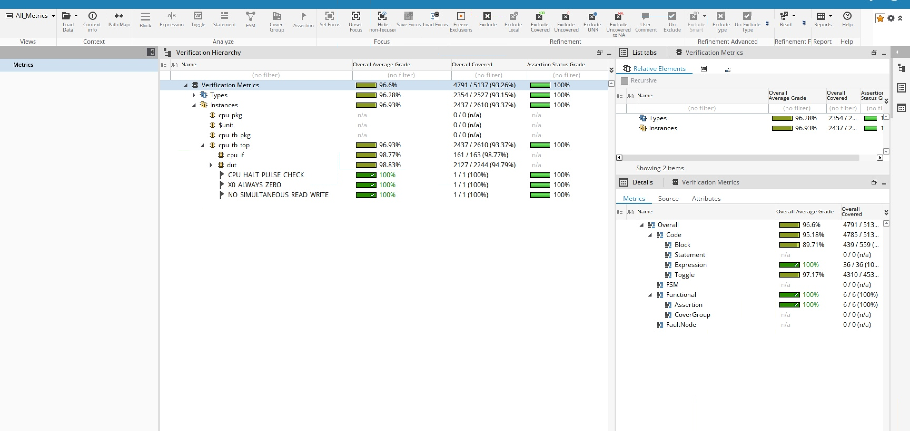
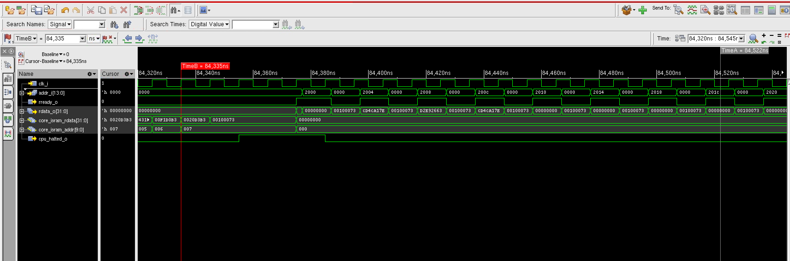

# Design Verification: CPU Onboarding

SiliconJackets Fall 2026 DV onboarding. The design under test is my CPU from the
[digital design onboarding](../rtl/README.md), wrapped in a chip top with instruction SRAM, data SRAM
and an external port. The club supplied a non-UVM testbench scaffold (interface, sequencer,
reference model, package) with parts left open. I wrote the test plan, filled in the open
constraints, driver, monitor and scoreboard paths, added the directed tests and assertions, and then
ran the finished bench against an encrypted CPU with three injected bugs.

Tools: Cadence Xcelium (`xrun`), SimVision for waveforms, IMC for code coverage.

## Testbench

The sequencer builds random programs and external-port accesses and hands them to the driver
through a mailbox. The driver turns them into pin activity, the monitor rebuilds what actually
happened on the bus, and the scoreboard compares that against a reference model that runs the ISA
without pipeline timing.

## Test plan

The full plan is in [testplan/testplan_final.md](testplan/testplan_final.md); the first-week
version reviewed by the leads is [testplan/testplan_initial.md](testplan/testplan_initial.md).

- **Directed tests (12):** SRAM and register windows at their first and last words, register-window
  address aliasing, ADDI with negative immediates, BEQ taken and not taken, back-to-back BEQs,
  SLL/SRL at 0 and 31, LW/SW at both ends of data SRAM, every data SRAM word in a loop, consecutive
  stores including zero data, writes to `x0`, and the halt pulse.
- **Constrained random:** 20 programs per seed by default with up to 300 external-port accesses
  between them. I completed the immediate, memory-alignment, branch-target, taken-branch bias,
  register-window and data-corner constraints. Alignment is constrained on the runtime `rs1 + imm`
  address, since an aligned immediate on an unaligned base still misses.
- **Assertions (3):** `NO_SIMULTANEOUS_READ_WRITE`, `X0_ALWAYS_ZERO`, `CPU_HALT_PULSE_CHECK`. Each
  was checked by forcing a violation and confirming it fired.

## Results

| Run | Result |
| --- | --- |
| Member CPU, full suite, seed 1 | PASS, 0 scoreboard mismatches |
| Encrypted `bug_hunt_cpu_1`, seed 1 | 67 scoreboard mismatches |
| Minimized reproducers on encrypted CPU | 16 mismatches |
| Minimized reproducers on my CPU | 0 mismatches |
| `dut` code coverage (IMC) | 98.80% average cumulative block coverage |

## Bug hunt

Each bug was found by the random test, then cut down to a short program taken directly from the
logged failing program (same registers and immediates), then narrowed with small variations.

| Bug | Trigger | Effect |
| --- | --- | --- |
| 1 | SLL or SRL with bit 5 of `rs2` set | Result is 0; the shift amount is taken from `rs2[5:0]` instead of `rs2[4:0]` |
| 2 | BEQ directly after an LW that writes one of its operands | The branch compares against the register's value from before the load. One NOP in between fixes it, and an ADDI in the same spot does not trigger it |
| 3 | LW directly after an SW to a different word whose address matches in bits [3:0] | The SRAM returns the right word, but the LW destination gets the SW's data |

Waveforms for each are in [screenshots/](screenshots/), and section 4 of the final plan walks
through each one cursor by cursor.

## Files

| Path | Contents |
| --- | --- |
| `testplan/` | Initial and final test plans |
| `tb/` | Testbench sources (pending club permission) |
| `evidence/` | Assertion-failure excerpts and the reproducer runs on both CPUs |
| `screenshots/` | Waveforms, coverage, testbench diagram |
| `coverage/coverage_summary.txt` | IMC text summary |
