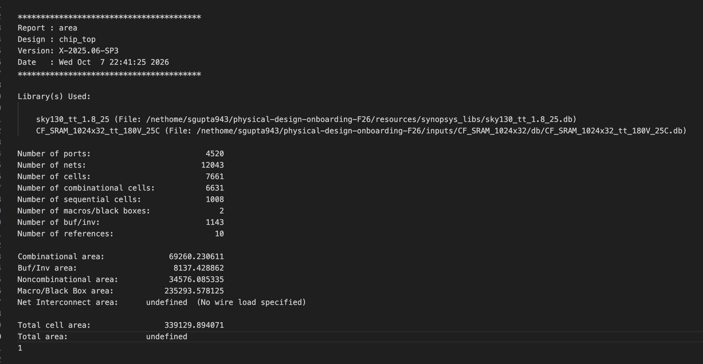
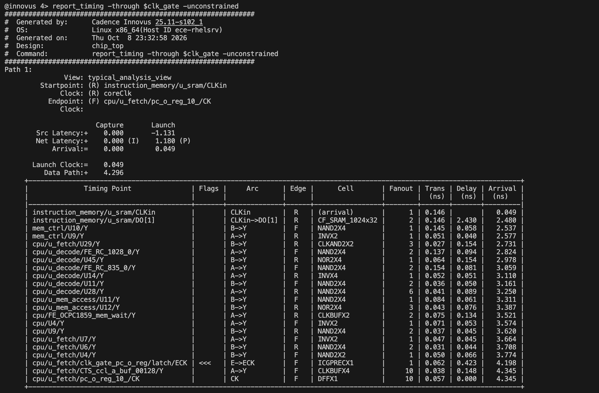
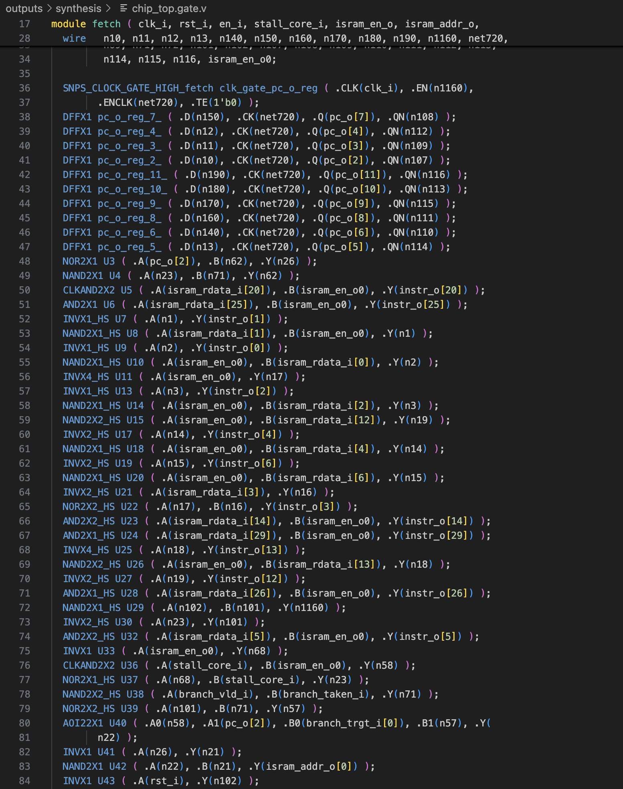
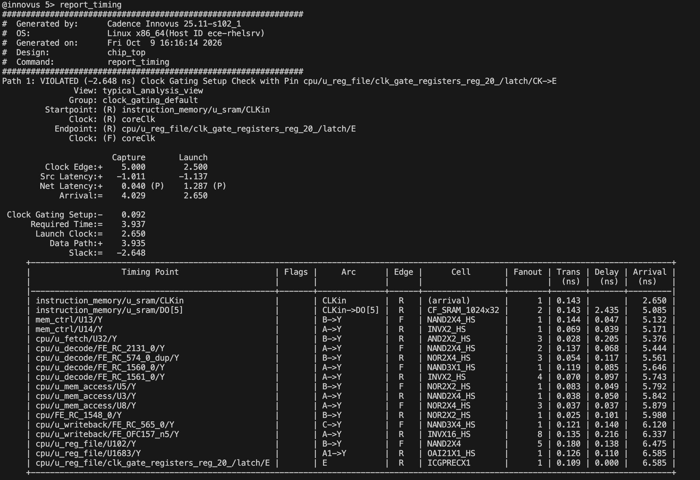
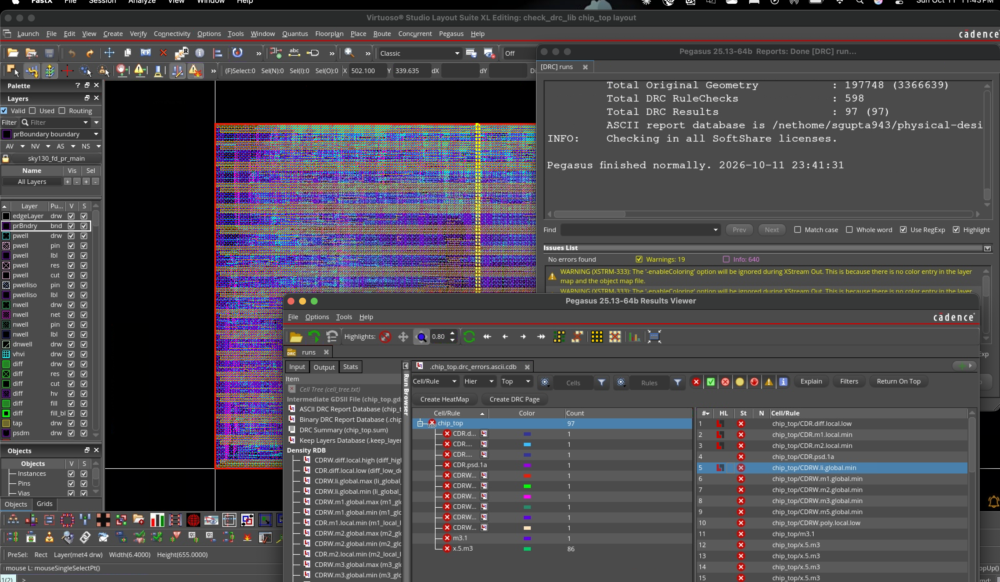
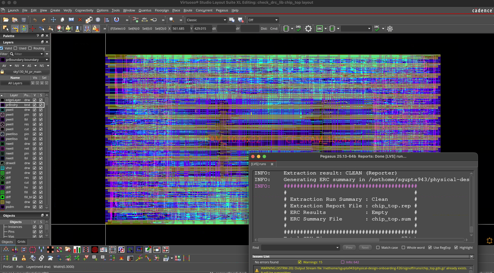

# Physical Design

This stage takes `chip_top` (the CPU from [rtl/](../rtl/README.md), the memory controller and two
1024 x 32 SRAM macros) from RTL to a routed layout on the SkyWater 130 nm process. It followed the
SiliconJackets Fall 2026 physical design onboarding: six parts, each answered on a slide in my final
submission deck.

| Step | Tool |
| --- | --- |
| Synthesis | Synopsys Design Compiler |
| Floorplan, placement, clock tree, routing, timing | Cadence Innovus |
| DRC and LVS signoff | Cadence Pegasus in Virtuoso |

Standard cells come from the `sky130_scl_9T` library (normal and high-speed variants). The target
clock is `coreClk` with a 5.0 ns period (`scripts/config.tcl`).

> **Can it be rerun?** Not outside Georgia Tech. The flow calls licensed Cadence and Synopsys tools
> on the ECE servers and expects the club's `resources/` setup (sky130 collateral and compiled
> libraries). The scripts, reports and screenshots here show what was done and what came out.

Each number below names its source: **deck** means my submission slide for that part, and
**report** means a file under `outputs/` in this folder.

## 1. Synthesis

From the Design Compiler area report (deck 1.1a):

| Metric | Value |
| --- | --- |
| Cells | 7661 (6631 combinational, 1008 sequential, 2 macros) |
| Buffers and inverters | 1143 |
| Macro area | 235,293.578 |
| Total cell area | 339,129.894 |

The output, `chip_top.gate.v`, is the gate-level netlist that place and route, equivalence checking
and gate-level simulation all start from.

## 2. Floorplan

**Core size (deck 2.1a).** Each SRAM macro measures 387.870 x 306.775 and gets a 21 µm halo on every
side, so one macro plus halo takes (387.870 + 42) x (306.775 + 42) = 149,927.909 µm². Two of them
need 64,562.24 more than the raw macro area, which brings the cell area to 403,692.134. At 50%
utilization and a 2:1 aspect ratio that gives a core of **1,270.736 x 635.368 µm**.

**Placement and power (deck 2.2–2.3, `scripts/apr/steps/step_floorplan.tcl`).**

- The data SRAM is fixed at (257.05, 173.90) and the instruction SRAM at (644.92, 173.90).
- Both macros are grouped and wrapped in a VDD/VSS block ring on met4/met5 (width 6.2, spacing 3.2,
  offset 5). Large macros draw a lot of current; without power close by, IR drop and
  electromigration around them get worse.

**Utilization (deck 2.4a).** `checkFPlan -reportUtil` reported a core utilization of 50.08% and a
standard-cell density of 0.202 for that run.

## 3. Timing analysis

Worst setup path before any optimization (deck 3.1a):

- From the instruction SRAM to register 11 in the register file
- Path delay 6.770 ns, slack −1.868 ns
- The SRAM's `CLKin -> DO` arc alone takes 2.331 ns, and the path passes through 34 cells, about
  half of them buffers and inverters.

To get total negative slack I wrote `fetch_tns` (`scripts/helpers/fetch_tns.tcl`), which sums the
slack of every failing path. Result (deck 3.2b): **WNS −1.868 ns, TNS −1554.3 ns**.

## 4. Clock gating

I added `-gate_clock` to every compile command in `scripts/synthesis/steps/step_compile.tcl`, and
the tool inserted integrated clock-gating cells (`ICG*`). `ICGPRECX1` alone is used 32 times
(deck 4.2b).

A path through one of the gates. `report_timing` needs `-unconstrained` here because it does not
time clock paths by default:

With clock gating: **WNS −2.795 ns, TNS −1728.237 ns** (deck 4.3b).

## 5. Cell swapping

I added the high-speed (HS) variant of the standard cell library so the tools can use faster cells
where timing needs them:

- Synthesis: HS best, typical and worst `.db` files in the target and link libraries, with
  `set_min_library` for HS min and max delay (`scripts/synthesis/steps/step_define_library.tcl`)
- Place and route: the HS `.lef` in `step_init_design.tcl` and the HS typical `.lib` in
  `step_corners.tcl`

HS cells show up in the netlist with an `_HS` suffix:

Result (deck 5.2c): **WNS −2.648 ns, TNS −1280.08 ns**. Against clock gating alone, WNS improved by
0.147 ns and TNS by 448.16 ns. The worst path still starts in the instruction SRAM but now ends at
the clock gate of register 20. Its depth fell from 34 cells to 16 (15 of them HS) and its delay from
6.770 ns to 3.935 ns.

## 6. Signoff

**DRC (deck 6.1).** Pegasus finished with 97 results over 598 rule checks. 86 of them come from one
rule, `x.5.m3`, and these violations are still open. The remaining 11 are single hits: ten on `CDR`/`CDRW` rules, mostly local and global layer density
checks, and one on `m3.1`.

**LVS (deck 6.2).** LVS is clean: Pegasus reports extraction CLEAN with no ERC results.

## Final routed run

From the last full run (October 11), in `outputs/`:

| Check | Value | Report |
| --- | --- | --- |
| Setup WNS / TNS | −2.648 ns / −1280.7 ns, 1089 failing paths | `apr/timingReports/chip_top_postRoute.summary.gz` |
| Hold WNS | 0.188 ns, no failing paths | `apr/timingReports/chip_top_postRoute_hold.summary.gz` |
| Core utilization | 46.98% | `apr/util.txt` |
| Dynamic power (synthesis estimate) | 21.32 mW | `synthesis/RPT/report.power` |

Hold timing closes. Setup does not close at 5.0 ns: the slowest paths begin at the SRAM output,
whose clock-to-data delay is already about 2.4 ns.

## What is here

| Path | Contents | Source |
| --- | --- | --- |
| `scripts/` | Synthesis and Innovus flow | Club flow. My changes: `step_floorplan.tcl`, `step_compile.tcl`, `step_define_library.tcl`, `step_init_design.tcl`, `step_corners.tcl`, `step_place_std_cells.tcl`, and the new `helpers/fetch_tns.tcl` |
| `inputs/` | RTL that was synthesized, plus the SRAM macro collateral | RTL is mine (see [rtl/](../rtl/README.md)); macro files come from the vendor through the club |
| `outputs/` | Synthesis and place-and-route reports, logs and databases | My runs |
| `signoff/` | Pegasus DRC and LVS setup and results | Club setup, my runs |
| `screenshots/` | Images from my submission deck | Mine |
| `docs/`, `Makefile`, `envsetup` | Onboarding guides and flow entry points | Club |
