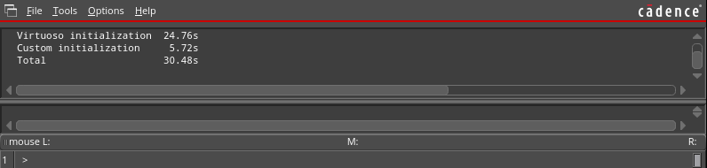
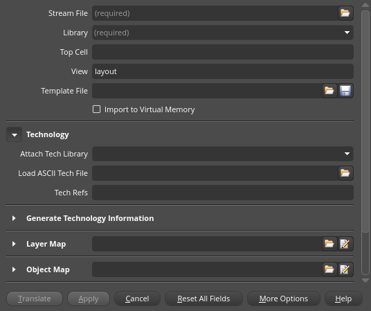
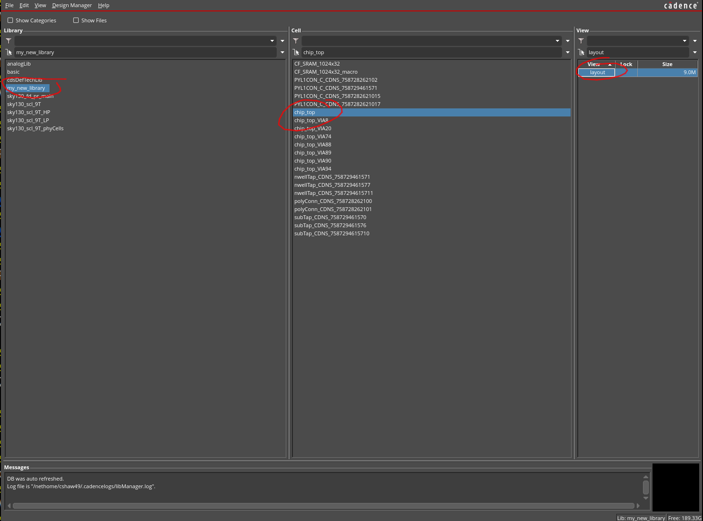
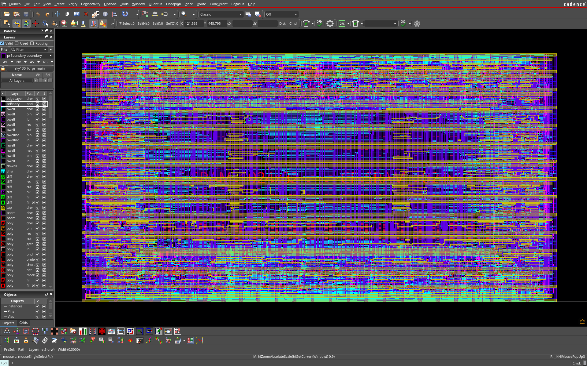
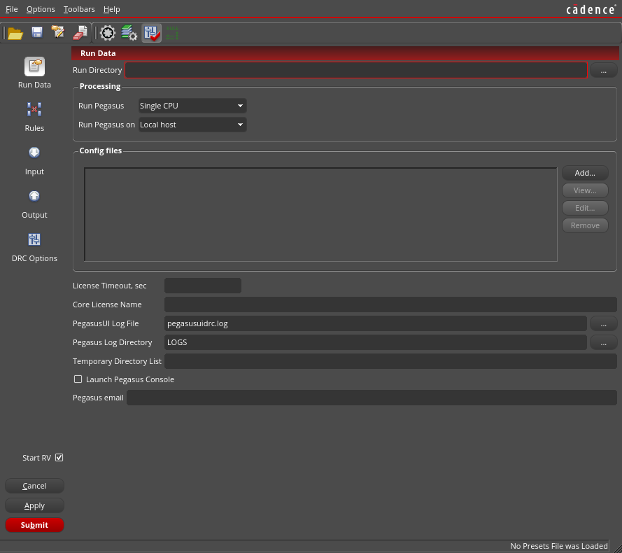
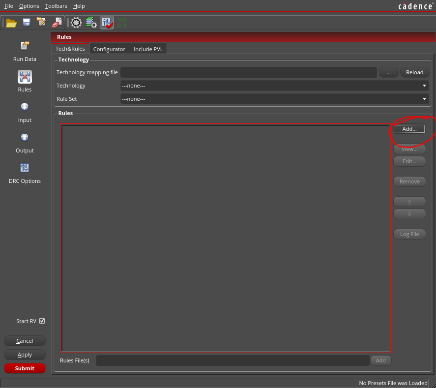
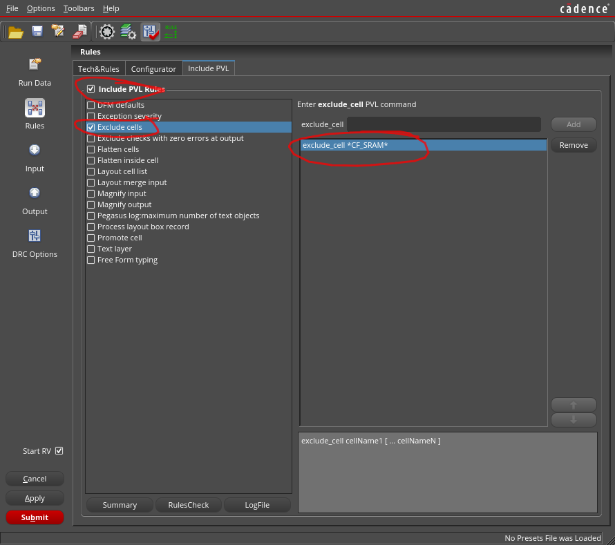
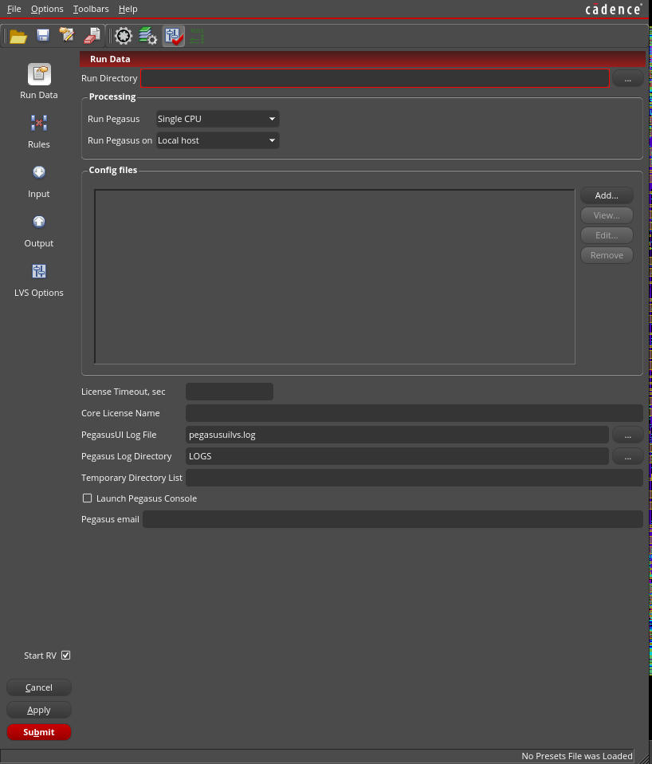
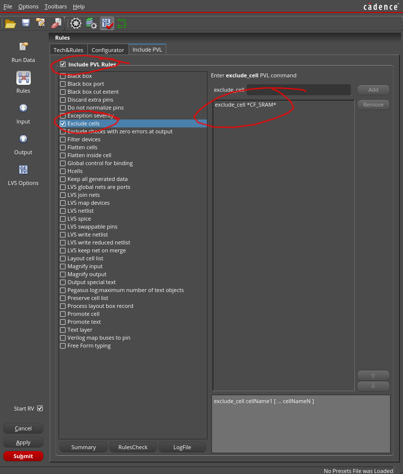
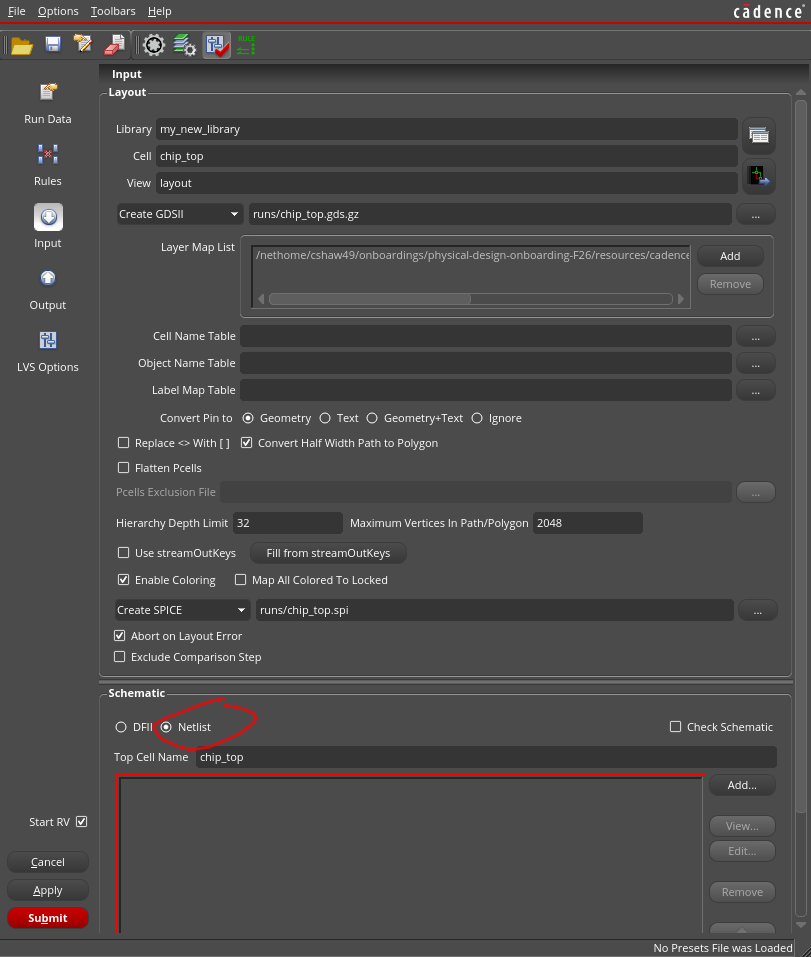

# Running DRC and LVS
> To follow this doc, you will need to have successfully run the flow to completion.
>
> You will need the files `outputs/apr/DBS/<design_name>.phy.v` and `outputs/apr/DBS/<design_name>.merged.gds`.

DRC and LVS are run in Pegasus, a tool within Cadence Virtuoso.

First, we need to stream our GDS into a new library.

**To stream in a GDS:**

1. Enter the signoff directory with `cd $wd/signoff`.

	This directory is prepopulated with a `cds.lib` that contains some libraries we will reference when creating our own.

> Note: If `cd $wd/signoff` didn't work, you're probably not in `SJapr`. Please run `tcsh` and `source envsetup` before continuing.	

2. In this directory, run `make virtuoso`.

	This will open the Virtuoso GUI. Give it up to a minute to load.

> Note: This opens a GUI. That means we must do this from within FastX.
>
> 

3. In the GUI, select `File > Import > Stream`. This opens a new window.

4. In the new window, specify the following information:

| Field | Value |
| ----- | ----- |
| Stream File | `outputs/apr/DBS/<design_name>.merged.gds`. You will have to click the folder icon, then navigate to the gds file.  |
| Library | A name for your new library (can be anything, just don't select from the dropdown) |
| Attach Tech Library | `sky130_fd_pr_main` (from the dropdown). This populates some of the other fields automatically. |

5. Click `More options`. In the new window, click the folder icon for the `Ref Lib File Name` field and choose `NoCollateral.reflib`.

6. Click `Ok`, then click `Apply`. It will load for a moment, then you should get a message that it finished with 0 errors.

	Your library is created.

**To open your library:**

1. In the original Virtuoso menu, choose `Tools > Library Manager`. A new window opens.

2. In the Library Manager window, choose your library, then choose the name of your toplevel cell (probably `chip_top`), then click `layout`.

	
	
	The tool will load for a moment, then your layout will appear.

	

**To run DRC on your design:**

1. With your design's layout open (as above), click `Pegasus > Run DRC` in the top bar. The Pegasus DRC window opens.

	

2. In the `Run Data` sidebar, click the three dots next to the `Run Directory` field, and select the `signoff/runs/` directory, then click `Choose`.

3. In the `Rules` sidebar, click the `Add` button.

	

	In the popup, navigate to `resources/cadence_sky130/sky130_release_0.1.0/Sky130_DRC/` and choose the file `sky130_rev_0.0_2.12.drc.pvl`, then click `Open`.

	In the `Configurator` tab, check the `Use Configurator` box, then click the three dots next to the `Input` field.

	In the popup, navigate to `resources/cadence_sky130/sky130_release_0.1.0/Sky130_DRC/` and choose the file `sky130.drc.cfg`, then click `Open`.

	In the `Include PVL` tab, check the `Include PVL Rules` checkbox, then check the `Exclude Cells` checkbox. In the `exclude_cell` field on the right, type `*CF_SRAM*`, then click `Add`.

	

4. Click `Submit`. This will run DRC and generate a report.

> Note: We don't intend for you to fix these DRCs, but it is important that you understand what is causing them. 
>
> Try to click the errors in the post-run popup -- the tool will highlight the region the selected error is in in the layout.

**To run LVS on your design:**

1. With your design's layout open (as above), click `Pegasus > Run DRC` in the top bar. The Pegasus DRC window opens.

	

2. In the `Run Data` sidebar, click the three dots next to the `Run Directory` field, and select the `signoff/runs/` directory, then click `Choose`.

> If you just ran DRC, you'll probably get a popup asking if you want to overwrite this directory later. If that happnes, just click `Ok`.

3. In the `Rules` sidebar, click the `Add` button.

	In the popup, navigate to `resources/cadence_sky130/sky130_release_0.1.0/Sky130_LVS/` and choose the file `sky130.lvs.v0.0_1.1.pvl`, then click `Open`.

	In the `Include PVL` tab, check the `Include PVL Rules` checkbox, then the `Exclude cells` checkbox. In the `exclude_cell` field on the right, type `*CF_SRAM*`, then click `Add`.

	

4. In the `Input` sidebar, click the `Netlist` radio button under `Schematic`.

	

	We have to add a number of files in this section. Add the following:
	- `outputs/apr/DBS/<design_name>.phy.v` (LVS is *Layout* vs *Schematic*. The GDS is our Layout, and this file is our Schematic!)
	- `signoff/CF_SRAM_1024x32.cdl`
	- `resources/cadence_sky130/sky130_scl_9T_0.1.2/sky130_scl_9T/cdl/sky130_scl_9T.cdl`
	- `resources/cadence_sky130/sky130_scl_9T_0.1.2/sky130_scl_9T_tech/cdl/sky130_scl_9T_phyCells.cdl`
	- `resources/cadence_sky130/sky130_scl_9T_0.1.2/sky130_scl_9T_LP/cdl/sky130_scl_9T_LP.cdl`
	- `resources/cadence_sky130/sky130_scl_9T_0.1.2/sky130_scl_9T_HS/cdl/sky130_scl_9T_HS.cdl`

4. Click `Submit`. This will run LVS and generate a report.

> Note: We don't intend for you to fix these LVS errors, but it is important that you understand what is causing them. 
>
> Try to read the output and identify the source of the LVS errors.
